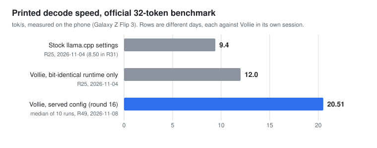
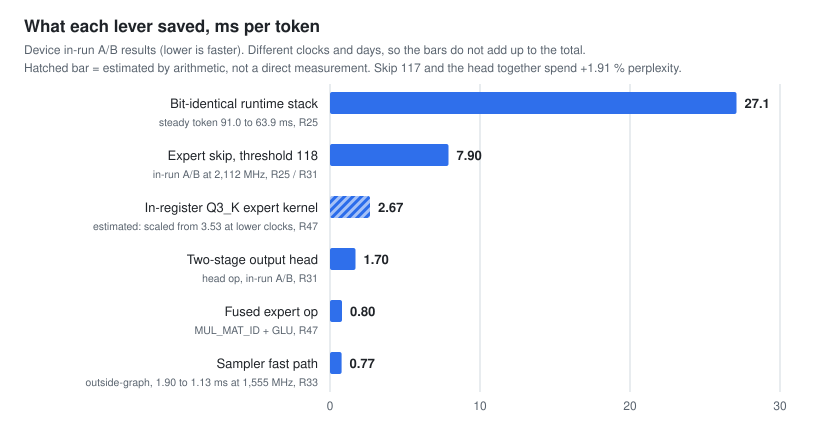

# Vollie: a mixture-of-experts LLM at 20 tok/s on a 2021 phone CPU

This repository is the **experiment**: runtime patches for llama.cpp, the tools that check them, and the full
log of every measurement behind a 7B mixture-of-experts model running at 20 tok/s on a phone CPU.

**[Vollie](https://play.google.com/store/apps/details?id=com.insaneutils.vollie) is the Android app that runs
this work, so you can reproduce the result on your own phone.** See [Run it on your phone](#run-it-on-your-phone).
The app's source code is not in this repository.

> **Campaigns.** This page and everything below it describe **campaign 1** (20 tok/s, +2 % perplexity), which is
> finished and frozen at commit `686f17d`. Campaign 2 (25 tok/s, +5 %, a 7B-class model still to be chosen)
> is in planning; nothing in it has been measured. Index and shared principles: [campaigns/](campaigns/README.md).

- **Device:** Samsung Galaxy Z Flip 3 (Snapdragon 888: 1x Cortex-X1 + 3x A78 + 4x A55, 8 GB).
- **Model:** Granite-4.0-H-Tiny abliterated (7B mixture-of-experts, 64 experts, Mamba-2 hybrid), one frozen
  GGUF ([recipe and sha256](models/granite-4.0-h-tiny-d6-e6.md); weights on Hugging Face in
  [HoeioUser/vollie-qwen3.5-4b](https://huggingface.co/HoeioUser/vollie-qwen3.5-4b), a repository name
  from before the switch to Granite).

## The result

Vollie's own benchmark (official prompt, 32 tokens, greedy, llamadart's `decodeTokensPerSec`) printed a
**median of 20.51 tok/s** over 10 runs (*device*, R49, round 16, research build 2.2.21+44, kit r16).



- 8 of 10 runs printed 20.2-20.95. Best 20.95. The 10 runs: 14.09, 18.47, 20.63, 20.62, 20.23, 20.83,
  20.95, 20.40, 20.84, 20.25.
- Every one of them ended with the fast cores at 2,112 / 2,035 MHz. Each run waited first at the kit's
  cool-down gate, as the app's speed test does.
- The claim rule was written before the run: "20 reached iff the median of the 10 plain runs is
  ≥ 20.0", never from a best run. The prediction was median 18.0-20.0, central 19.0. It missed high.
- Greedy text was identical across all 19 official runs of the session.
- **Cold start is slower: 12.3-18.5 tok/s** (*device*, R49). The cause is page residency, not arithmetic:
  the model's pages had been evicted and faulted back in during the prefill and the first decode tokens.
  Once they are resident, the steady official token is ≈ 45.5 ms in the graph + ≈ 1.05 ms outside it.

The three bars are three different days, each measured against Vollie in the same session (*device*, same
phone, same model file). Where each number is logged: R25 (9.4 and 12.0, 2026-11-04), R31 (8.50 for stock
settings, 2026-11-06), R49 (20.51, 2026-11-08). The "stock" bar is llama.cpp with every Vollie knob off; the
exact definition is in the footnote of [the round-5 comparison](docs/round5-comparison.md).

## Run it on your phone

The results here are not only logs: the app contains the patched runtime, and its own benchmark is the one the
headline number comes from.

1. Install [Vollie from Google Play](https://play.google.com/store/apps/details?id=com.insaneutils.vollie). The
   store build carries the round-16 configuration (R49).
2. In Settings, run **Optimize for this phone** for a quick speed test, or **Run research kit** for the full
   measurement behind R49 (about 9-35 minutes, no settings to change).
3. The kit ends with **Copy research results**, one JSON report on the clipboard. Read it with
   `python3 -I tools/research_parse.py <report.json> --official` and compare it with the raw reports of the
   Z Flip 3 in [reports/device/](reports/device/).

Steps, what to expect and how to read the numbers: [docs/run-on-your-phone.md](docs/run-on-your-phone.md).

### Share a result from your phone

**If you run the research kit on a different phone and email us the report, we would be very grateful.** Every
result here comes from one phone and one model; reports from other devices are the evidence we cannot produce
ourselves. Send the JSON file, with your phone's model name and Android version, to
**woobin3069@gmail.com**. What a report contains and what to include: [docs/run-on-your-phone.md](docs/run-on-your-phone.md#share-your-result).

## The rules it was done under

The full text is [RULES.md](RULES.md). In short:

- **Quality gate:** wikitext-2 perplexity (`llama-perplexity`, test set, context 512, all chunks,
  `tools/ppl.sh`). Hard limit +20 % over the model's F16 weights (9.0438, so ≤ 10.853). The served file's
  stock PPL is 9.6051.
- **One approved numerics budget for speed:** router-weight expert skip, +2 % over the served file
  (≤ 9.797), final for the campaign. The served config spends +1.91 % (9.7886, *host*; perplexity is
  machine-independent). That covers skip 117 and the two-stage head together.
- **Everything else is bit-identical:** `llama-perplexity` per-chunk values equal at `-ub 1`, `-ub 32`
  and `-b 512`, and every new knob is off-switchable.
- **The served file is frozen.** Speed comes from the runtime only. Nothing is asked of the user's phone.
- **Measured on the phone, predicted in advance.** Every speed number here is measured on the device by
  its owner through the app. The prediction and the pass rule of each round are written into
  [reports/03_final.md](reports/03_final.md) before the run, and scored as written, misses included.
- Labels: *device* = measured on the phone; *host* = measured on a laptop (Apple M4), relative or
  machine-independent only; *estimated* = arithmetic, not a measurement.

## What got there



In the served config: a bit-identical runtime stack (sync-skipping around small ops, expert prefetch, a
4-row Q3_K kernel, SSM state in place), router-weight expert skip at threshold 117, a two-stage output head,
a sampler fast path, an in-register Q3_K expert kernel and a fused expert op. The full table, with outputs,
device effects and where each is logged, is in [docs/levers.md](docs/levers.md).

## What did not work

Speculative decoding of every kind, early exit, 4 threads, anonymous-memory expert caches, OpenCL on the
Adreno 660 (0.7-2.9 tok/s, always below the CPU), and several others. Each was measured and closed; the
list with numbers is in [docs/negative-results.md](docs/negative-results.md).

## Reproduce

**Host checks, no phone needed.** `tools/reproduce.sh` builds llama.cpp at the pinned base with the
patches, downloads the model (sha256-checked) and wikitext-2, and checks two claims: bit-identity of the
runtime knobs (per-chunk PPL to the last digit) and the perplexity gate for stock vs
`GGML_EXPERT_SKIP=118`. `--quick` screens it. Verified 2026-11-05 from a clean clone on an Apple M4:
stock 9.6051, skip 118 9.7952 (`reports/results.csv`, R27 reproduce row). It checks skip 118, not the
served 117 + two-stage head pair.

**Android CPU module.** Apply the patches to the commit in `patches/llama.cpp/BASE`, then build with the
NDK:

```sh
git clone https://github.com/ggml-org/llama.cpp && cd llama.cpp
git checkout $(cat ../vollie/patches/llama.cpp/BASE)
for p in 0001-cpu-runtime 0002-granite-rollback 0003-sampler-bypass; do git apply ../vollie/patches/llama.cpp/$p.patch; done
../vollie/android/build_cpu.sh . out/        # libggml-cpu-android_armv8.2_2.so
```

Knobs are environment variables ([docs/runtime-knobs.md](docs/runtime-knobs.md)); the app sets them
on the phone, and `GGML_EXPERT_SKIP` stays off unless set. Example:

```sh
GGML_TINY_OP=262144 GGML_EXPERT_IO=5 llama-cli -m model.gguf -t 3 ...
```

## Where things are

| path | what |
|---|---|
| [docs/](docs/README.md) | overview, findings, levers, negative results, knobs, glossary, and [how to run it on your phone](docs/run-on-your-phone.md) |
| [reports/](reports/README.md) | readable index of the research log, with a one-line verdict per R-number |
| [RULES.md](RULES.md) | the conditions every change must meet |
| [reports/03_final.md](reports/03_final.md) | the original R-log, R1 to R49, with pre-registrations and verdicts |
| [reports/results.csv](reports/results.csv), [reports/device/](reports/device/) | one row per result; raw device JSON of every research-kit round (r1 to r16) |
| [patches/](patches/README.md) | llama.cpp CPU-module patch, Granite rollback patch, sampler patch, llamadart patch, pinned `BASE` files |
| [tools/](tools/README.md) | `reproduce.sh`, `ppl.sh` (quality gate), `research_parse.py` (device JSON parser), the research-kit card, host benchmarks, `checks/`, and the one-off analysis scripts, each described in its README |
| [android/](android/), [runtime/dart/](runtime/dart/) | build the module for Android; app-side helpers |
| [models/](models/) | how the served GGUF was made |

The original raw log files under `reports/` were not changed. The app's APKs and the host logs that the R-log
cites as `lab/...` are not in this repository.

## Honest limits

- **Cold start.** The first run after memory pressure printed 12.3-18.5, not 20 (R49). The loss is page
  residency at the start of a run. Fixing it in the runtime is open.
- **One device, one model.** Everything here is one Snapdragon 888 phone and one Granite file. The goal
  includes that the method generalizes to other models and devices; that is the next step and is not
  shown yet.
- **The metric.** The printed number is llamadart's `decodeTokensPerSec`. Its time includes one final
  decode whose logits are never used, ≈ 3 % of the official number (*estimated*, R48). It was left in, so
  the benchmark's definition did not change.
- **Not scored.** Round 16's second line, which was to split the gap between ramp and faults, was
  unscorable (R49): its reference story ran throttled.
- **Build versions.** The 20.51 was measured on research build 2.2.21+44. The Google Play build carries the
  same configuration: the production build 2.3.0+45 has the same native code (see the paragraph after R49 in
  [reports/03_final.md](reports/03_final.md)).

## License

MIT (see [LICENSE](LICENSE)), like llama.cpp and llamadart, which the patches apply to.
